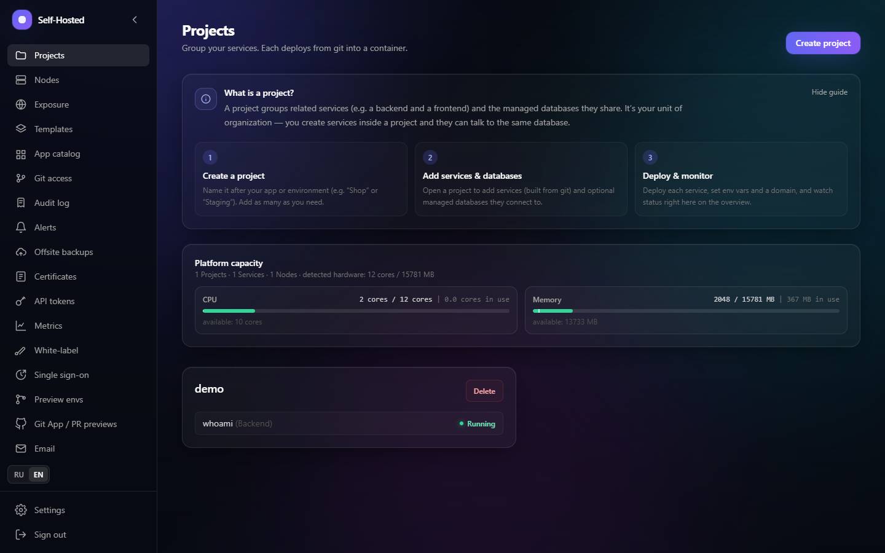
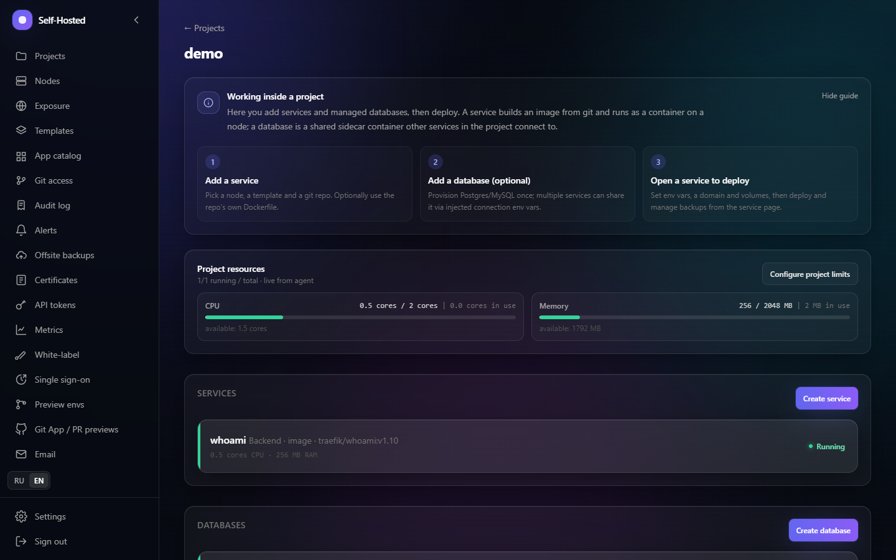
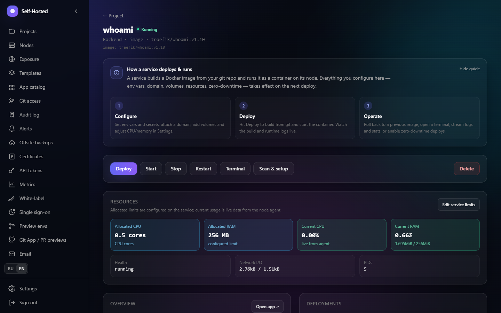
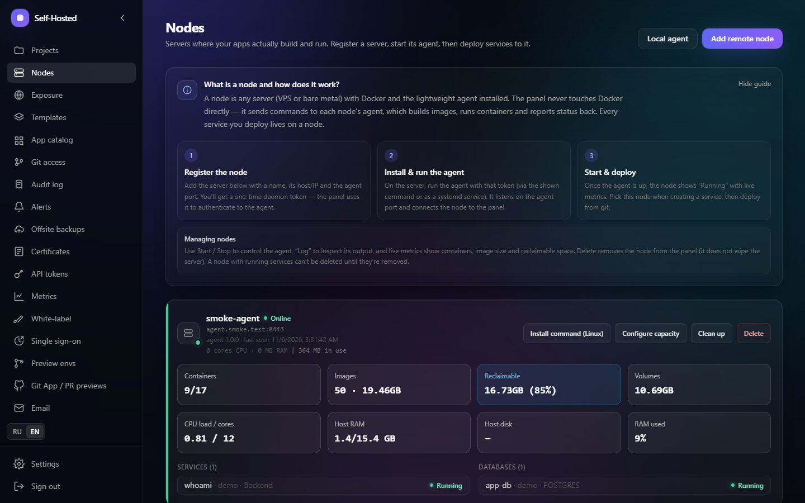
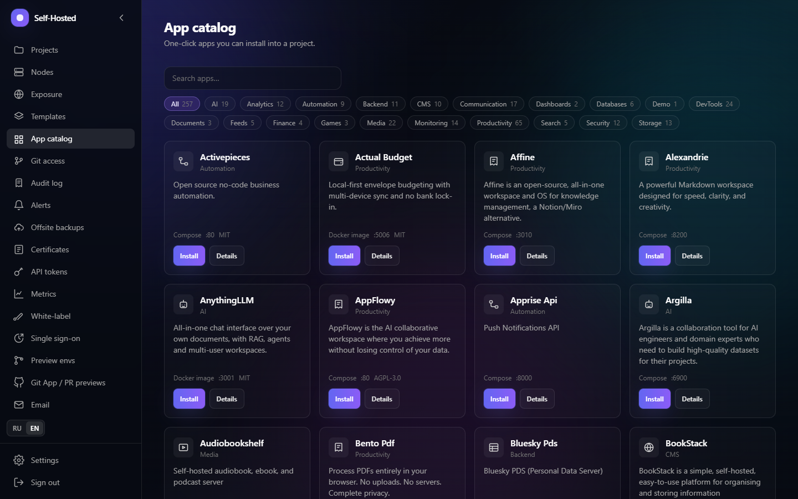

<div align="center">

# Self-Hosted

**Деплой приложений из git, Docker-образов или Compose на ваши собственные серверы.**
Открытая self-hosted альтернатива Heroku, Vercel и Coolify.

[](https://github.com/KROWIEL/self-hosted/actions/workflows/ci.yml)
[](https://github.com/KROWIEL/self-hosted/releases/latest)
[](LICENSE)
[](CONTRIBUTING.md)

[Сайт](https://krowiel.github.io/self-hosted/ru/) · [Установка](docs/INSTALL.ru.md) · [Релизы](https://github.com/KROWIEL/self-hosted/releases) · [English](README.md) · **Русский**

</div>

---

Self-Hosted — панель деплоя, которую вы запускаете у себя. Укажите репозиторий,
образ контейнера или Compose-файл, и панель соберёт, запустит и опубликует
приложение по HTTPS на ваших серверах: на одном VPS, на нескольких машинах или
в домашней лаборатории за NAT.

Всё бесплатно и открыто под лицензией MIT. Нет платных тарифов, ключей лицензии
и ограничений по числу серверов, пользователей или приложений.

## Возможности

- **Три способа деплоя**: сборка из **git** (готовые шаблоны, ваш `Dockerfile`
  или автоопределение через Nixpacks), запуск **образа** или **Compose**-стека.
- **Каталог приложений**: 250+ приложений в 20 категориях с установкой в один
  клик (Immich, Jellyfin, Gitea, Vaultwarden, Ollama…).
- **Managed-базы**: PostgreSQL и MySQL на проект, бэкапы по расписанию,
  восстановление и внешние копии в S3, GCS, Azure Blob или SFTP.
- **Релизы без простоя**: blue-green деплой с проверкой health и откат на любой
  предыдущий образ в один клик.
- **Автоматический HTTPS**: Traefik и Let's Encrypt (сертификат на домен или
  wildcard через DNS-01), либо загрузка своего сертификата.
- **Много серверов, одна панель**: небольшой Go-агент на каждом сервере,
  подключается одной командой; обратные туннели публикуют серверы без белого IP.
- **Превью-среды**: окружения на ветку и на pull request по вебхукам GitHub и
  GitLab.
- **Команды**: мульти-тенант проекты с квотами CPU/RAM, роли `OWNER / ADMIN /
  MEMBER / VIEWER`, аудит-лог с экспортом в CSV/JSON, единый вход через OpenID
  Connect.
- **Повседневные инструменты**: живые логи сборки и работы, метрики с историей,
  терминал в браузере, cron внутри контейнеров, алерты в webhook, Discord, Slack
  или Telegram, API-токены, исходящая почта и white-label.
- **Безопасность**: двухфакторная аутентификация TOTP, строгая парольная
  политика, шифрование секретов (AES-256-GCM), TLS-пиннинг агентов, rate limit.
- **Интерфейс на русском и английском** «из коробки».

## Скриншоты

<p align="center">
  
</p>

| Проект | Сервис и логи |
|---|---|
|  |  |

| Ноды | Каталог приложений |
|---|---|
|  |  |

Остальные — в [`docs/screenshots/`](docs/screenshots).

## Установка на сервер

Нужен Linux-сервер (рекомендуются Ubuntu 22.04+ или Debian 12+, от 2 ГБ ОЗУ),
домен, DNS-запись которого указывает на этот сервер, и открытые порты **80**,
**443** и **8443**. Выполните:

```bash
curl -fsSL https://raw.githubusercontent.com/KROWIEL/self-hosted/main/deploy/install.sh | sudo sh
```

Скрипт поставит Docker, если его нет, спросит домен панели и email для
Let's Encrypt, сгенерирует все секреты, запустит панель и выведет пароль
администратора. Откройте `https://<ваш домен>`, войдите, затем в разделе
**Ноды → Добавить удалённую ноду** получите команду и выполните её на этом же
сервере: она установит агента, который собирает и запускает ваши приложения.

Чтобы добавить ещё один сервер, подготовьте его командой
`curl -fsSL https://raw.githubusercontent.com/KROWIEL/self-hosted/main/deploy/install.sh | sudo sh -s node`
и подключите так же через **Ноды**.

Для обновления запустите команду установки ещё раз: настройки и данные
сохранятся. Полная инструкция с DNS, wildcard-сертификатами, бэкапами и
решением проблем — в [`docs/INSTALL.ru.md`](docs/INSTALL.ru.md).

## Локальная разработка

Нужны Node.js 24 LTS, Docker с Compose и Go 1.25+ для агента.

```bash
git clone https://github.com/KROWIEL/self-hosted.git
cd self-hosted
./start.sh        # Windows: ./start.ps1
```

Скрипт создаст `.env` из [`.env.example`](.env.example), запустит PostgreSQL и
Redis, применит схему, создаст администратора и запустит API на `:3001` и
интерфейс на http://localhost:3000. Ручные шаги — в
[`docs/INSTALL.ru.md`](docs/INSTALL.ru.md#локальная-разработка).

## Документация

| Документ | О чём |
|---|---|
| [`docs/INSTALL.ru.md`](docs/INSTALL.ru.md) | Установка на сервер, добавление серверов, настройка, обновление, бэкапы, локальная разработка, проблемы |
| [`docs/ARCHITECTURE.md`](docs/ARCHITECTURE.md) | Как устроены панель, агент и Traefik; структура репозитория; модель безопасности (англ.) |
| [`docs/ROADMAP.md`](docs/ROADMAP.md) | Что готово и что планируется (англ.) |
| [`CHANGELOG.md`](CHANGELOG.md) | Изменения по релизам |
| [`CONTRIBUTING.md`](CONTRIBUTING.md) | Как собрать, протестировать и прислать изменения |

## Архитектура

- **`apps/control-plane`** — API на NestJS (аутентификация, RBAC, оркестрация деплоя, аудит).
- **`apps/web`** — дашборд на Next.js 14.
- **`services/agent`** — Go-демон на каждом сервере (сборка, контейнеры, health-проверки, логи, туннели).
- **`packages/shared`** — общие TypeScript-типы для API и интерфейса.
- **Инфраструктура** — PostgreSQL, Redis (BullMQ) и Traefik.

## Участие

Issues и pull request'ы приветствуются. Сначала прочитайте
[`CONTRIBUTING.md`](CONTRIBUTING.md); об уязвимостях сообщайте по
[`SECURITY.md`](SECURITY.md), а не в публичных issues.

## Лицензия

[MIT](LICENSE). Используйте, копируйте, изменяйте, продавайте и хостите для
других — достаточно сохранить уведомление об авторских правах. Большинство
манифестов каталога основаны на шаблонах Coolify под Apache-2.0, см.
[`NOTICE`](NOTICE).
